# BlockBard Architecture & Development Roadmap

**Minecraft Version**: 26.3 (Fabric Loader 0.19.5, Fabric Language Kotlin 2.4.0, Java 25)  
**Last Updated**: November 2026 (Pass 15, Pass 16, Pass 17, Pass 18 & Pass 23 completed)  
**Test Suite**: 140 tests passing (`./gradlew test --no-daemon`)

---

## 1. Architectural Overview & Pass Milestones

```mermaid
graph TD
    subgraph Anticheat & Safety [Done: P1-P7]
        P1[P1: Logging Hygiene & Clipboard Crash Fix]
        P2[P2-P7: ProtocolMovementGuard, 100ms Packet Breaker, Convergence Gating, NBS Resampler]
    end

    subgraph Queue & Playback [Done: P9-P15]
        P9[P9: JUnit 6 & Classpath Probe]
        P10[P10: Pure PlayQueue & Deterministic Unit Tests]
        P11[P11: Repeat/Shuffle Migration & Sanitization]
        P12[P12: Wire PlayQueue into MainScreen]
        P13[P13: Queue UI - Next, Last, Move, Promote]
        P14[P14: PlaybackCoordinator Part 1 - Background Advance]
        P15[P15: TuningController Extraction & Scheduler Pool Bounds Fix]
    end

    subgraph Library & File Management [Next: P16-P17]
        P16[P16: MidiLibrary Consolidation & Open Folder Button]
        P17[P17: Folder Playlists & Relative Path ID Migration]
    end

    subgraph Tuner Reliability & Resilience [P18-P19]
        P18[P18: Tuner Telemetry & Diagnostics]
        P19[P19: Tuner Resilience & Partial Success D5]
    end

    subgraph Organ Optimization & Aim [P20-P22]
        P20[P20: Hungarian Min-Cost Organ Assignment D8]
        P21[P21: Angular Proximity Aim Sweeping]
        P22[P22: Cross-Instrument Zero-Click Matching]
    end

    subgraph Visualization & Diagnostic HUD [P23-P24]
        P23[P23: Reach & Organ Stand Overlay]
        P24[P24: Show Problems UI & Manual Highlighter]
    end

    subgraph Dynamic Retuning Rework [P25-P28]
        P25[P25: Song-Relative PlaybackClock Retune Timers]
        P26[P26: Scheduler Lifecycle & Seek Recompilation]
        P27[P27: Ghost-Note Budget & Dynamic Allocator]
        P28[P28: YACL Dynamic Retuning Integration]
    end

    subgraph Release Polish [P29]
        P29[P29: Documentation, Release Verification & Polish]
    end

    P1 --> P2
    P2 --> P9
    P9 --> P10
    P10 --> P11
    P11 --> P12
    P12 --> P13
    P13 --> P14
    P14 --> P15
    P15 --> P16
    P16 --> P17
    P17 --> P18
    P18 --> P19
    P19 --> P20
    P20 --> P21
    P21 --> P22
    P22 --> P23
    P23 --> P24
    P24 --> P25
    P25 --> P26
    P26 --> P27
    P27 --> P28
    P28 --> P29
```



---

## 2. Pass Status Matrix

| Pass | Code Name | Description | Status | Verification |
|---|---|---|---|---|
| **P1** | `log-hygiene` | Buffer truncation, tail text clipboard fix, suppress repetitive scan logs | **DONE** | LogBuffer unit tests |
| **P2–P7** | `anticheat-core` | `ProtocolMovementGuard`, 100ms packet breaker (limit 45), swing throttle, rotation gate | **DONE** | In-game anticheat tests |
| **P8** | `housekeeping` | Ignore `bin/` and XMLs in git | **DONE** | `.gitignore` verified |
| **P9** | `junit-spike` | JUnit Jupiter 6.1.2 setup, test classpath probe | **DONE** | `./gradlew test` |
| **P10** | `play-queue` | Pure `PlayQueue.kt` (repeat OFF/ALL/ONE, shuffle, user-queue priority) | **DONE** | 40 unit tests passing |
| **P11** | `config-migration` | `repeatMode` + `shuffle` orthogonal config, `/bb repeat`, `/bb shuffle`, sanitizing | **DONE** | 17 unit tests passing |
| **P12** | `wire-queue` | Wire `PlayQueue` into `MainScreen.kt`, delete duplicate queue managers | **DONE** | Integrated in UI |
| **P13** | `queue-ui` | Queue row actions (Next, Last, Move to Top, Promote) | **DONE** | GUI functional |
| **P14** | `coordinator-p1` | `PlaybackCoordinator` extracted; closed-screen auto-advance; `/bb play` tuner gate | **DONE** | Integrated in client tick |
| **P15** | `tuner-extraction` | Extracted `TuningController.kt`; decoupled screen from tuner; `CoverageMessage`; fixed `ArpeggioScheduler` voice pool bounds | **DONE** | All 68 tests passing |
| **P16** | `library-scanner` | Consolidate `midisDir`; implement `LibraryScanner` with cycle detection; "Open Folder" button via `Blaze3D.openPath` | **DONE** | 8 unit tests in `LibraryScannerTest` (75 total passing) |
| **P17** | `folder-playlists` | Folder playlists, relative path `SongId`, playlist cycle button, ID migration | **DONE** | Migration & scanner tests (83 passing) |
| **P18** | `tuner-telemetry` | Per-run diagnostic log line; query live `player.blockInteractionRange()` | **DONE** | Log & summary tests (140 passing) |
| **P19** | `tuner-resilience` | Per-block fail isolation; `DONE_PARTIAL` playback; dynamic reach limit (+0.5 creative) | **DONE** | 3 resilience & unassign tests |
| **P20** | `min-cost-mapper` | Hungarian algorithm (bipartite matching) for note block tuning with note usage weights | **DONE** | 16 unit tests (`HungarianAlgorithmTest`, `OrganAssignmentSolverTest`) |
| **P21** | `aim-sweeping` | Sort tune targets by angular proximity (yaw sweep) to reduce player head whipping | **DONE** | `AimOrderingTest` & `TuningController` aim integration |
| **P22** | `cross-timbre-0click` | Optional cross-instrument matching at 0 clicks for identical pitches | **OPTIONAL** | Configurable toggle |
| **P23** | `reach-overlay` | Hologram working vs non-working checks, out-of-reach crimson tint, silenced obstruction check, standPos cuboid and drift detection, 1.0f alpha visibility fix | **DONE** | Tested & verified in `OrganOverlayRenderer.kt` |
| **P24** | `show-problems` | "Show Problems" screen inspector; toggle for `ManualTuningHighlighter` | **PLANNED** | UI inspection |
| **P25–P28** | `dynamic-retuning` | Song-relative `PlaybackClock` retune tasks, ghost-note cap via `dynamicRetuningMaxClicks`, YACL sync | **PLANNED** | Allocation & clock tests |
| **P29** | `polish-release` | Documentation updates, final code cleanup, release notes | **PLANNED** | Full test & build pass |

---

## 3. Detailed Remaining Track Specifications

### Track A: Library & Playlists (Passes 16–17)
1. **Pass 16 — `MidiLibrary` Consolidation & "Open Folder" Button**:
   * **Implementation**:
     * Create pure `LibraryScanner.scan(root: Path, maxDepth: Int, maxFiles: Int): LibraryScan` in `main` source set.
     * Handle symlinks via `Files.walkFileTree(root, EnumSet.of(FileVisitOption.FOLLOW_LINKS))` with `FileSystemLoopException` catch.
     * Centralize config dir in `MidiLibrary.kt`.
     * Add "Open Folder" button on the Files tab calling `net.minecraft.util.Util.getPlatform().openPath(MidiLibrary.root.toPath())`.
   * **Tests**: Test `LibraryScanner` on temporary directories with symlinks, broken links, cycles, and file caps.

2. **Pass 17 — Folder Playlists & Relative Path `SongId` Migration**:
   * **Implementation**:
     * Transition `SongId` from flat file names (`song.mid`) to forward-slash relative paths (`classical/beethoven/ode.mid`).
     * Replace `name.equals(..., ignoreCase = true)` with relative path identity.
     * Add playlist cycle selector button on the Files tab: `"Playlist: All"`, click to advance, shift-click to retreat.
     * Implement idempotent migration in `ConfigManager`: map old bare filenames in `favorites` and `lastPlayedTrack` to new relative paths.

---

### Track B: Tuner Reliability & Resilience (Passes 18–19)
1. **Pass 18 — Tuner Diagnostics & Telemetry**:
   * **Implementation**:
     * Record a single structured summary line at the end of each tuning run:
       ```
       [BlockBard/Tuner] Run summary: targets=119 clicks=409 retries=1 time=2.4s ping=52ms reach=4.5 (creative=false) fails=[OCCLUDED:0, OUT_OF_REACH:0, UNRESPONSIVE:0, DESYNC:0]
       ```
     * Read actual reach distance using `player.blockInteractionRange()`.

2. **Pass 19 — Tuner Resilience & Partial Success (Decision D5)**:
   * **Implementation**:
     * Isolate per-block failure in `NoteBlockTuner.tickTuning`. When a block times out or fails, move to the next block instead of failing the entire tuning run.
     * Introduce `DONE_PARTIAL`: if certain blocks fail, proceed with playback, keep the remaining queue, highlight failed blocks via `ManualTuningHighlighter`, and silence only the missing notes.
     * Update `reachLimit(player)` helper dynamically: `range + 0.5` tolerance based on the active player state (4.5 survival, 5.0 creative).

---

### Track C: Optimal Organ Mapping (Passes 20–22)
1. **Pass 20 — Min-Cost Assignment (Hungarian Algorithm - Decision D8)**:
   * **Implementation**:
     * Replace greedy assignment pass in `MidiToOrganMapper.buildAssignment` with Kuhn-Munkres (Hungarian algorithm).
     * Model edge costs based on forward tuning clicks ($0 \le c < 25$).
     * Note usage weight: multiply missing-note penalty by note frequency so that prominent melody lines are guaranteed physical note blocks over single background notes.

2. **Pass 21 — Aim Sweeping Optimization**:
   * **Implementation**:
     * Sort tuning targets using angular distance / yaw sweep from current player look vector.
     * Minimize player head rotation time and prevent abrupt camera snapping during fast tuning.

---

### Track D: Visualizer & Diagnostics HUD (Passes 23–24)
1. **Pass 23 — Reach & Stand Overlay (Completed)**:
   * Highlight out-of-reach blocks in crimson and silenced blocks in orange in `OrganOverlayRenderer`.
   * Render standing position marker at `organMap.standPos` with player drift detection.
   * Fixed gizmo alpha multiplier from `0f` to `1.0f`.

2. **Pass 24 — Problem Inspector ("Show Problems")**:
   * Add a "Show Problems" button on the Organ tab listing untunable blocks, unreachable blocks, and unplayable notes with missing block suggestions (e.g. `Need: Clay for Flute`).

---

### Track E: Dynamic Retuning Rework (Passes 25–28)
1. **Pass 25–28 — Timed On-The-Fly Retuning**:
   * Sync retune scheduling with song-relative wall clock (`PlaybackClock`).
   * Enforce ghost-note limit through `dynamicRetuningMaxClicks` (default 2).
   * Integrate dynamic retuning toggle and parameters into YACL config save lifecycle.
